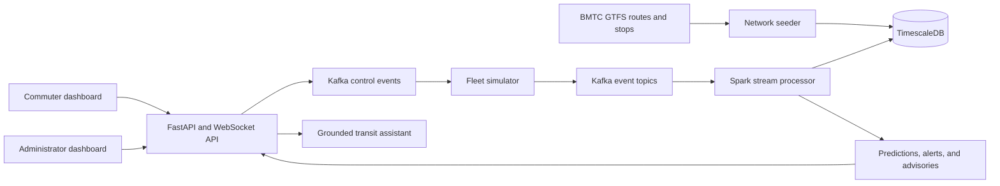

# Bus Pulse

**Bus Pulse is a Kafka-powered Agentic AI and stream-analytics platform for simulating Bengaluru BMTC buses, passenger crowding, capacity forecasts, and operational decisions.**

> **GitHub description:** Simulate Bengaluru BMTC bus operations with Kafka, TimescaleDB, Spark streaming, Agentic AI advisories, and separate commuter and administrator dashboards.

Bus Pulse is a real-time bus occupancy and prediction demo for Bengaluru. The static BMTC route network comes from GTFS; bus movement, passenger counts, occupancy, and incidents are simulated. This is not a live BMTC tracking or passenger-counting service.

The implementation follows [`Implementation_lite_deck-aligned.md`](Implementation_lite_deck-aligned.md). Kafka, TimescaleDB, the route loader, the simulator, API, and Spark streaming processor are implemented. The simulator starts paused; an administrator chooses a region and starts a fleet of up to `MAX_SIM_BUSES` (4,000 by default). See [`docs/DECISIONS.md`](docs/DECISIONS.md) for remaining validation and known limits.

## Highlights

- **Two dashboards:** commuters can plan and monitor a journey; administrators can operate regional simulations and respond to crowding.
- **Map-based journey planning:** select start and destination stops on the map, enter GPS coordinates, search routes, and inspect intermediate stops.
- **Live bus simulation:** run a city, region, or route-specific fleet with smooth simulated bus movement and configurable fleet size.
- **Demand scenarios:** demonstrate normal, moderate, and rush-hour crowding, including seated, standing, and handhold passenger estimates.
- **Streaming pipeline:** Kafka carries vehicle, passenger, telemetry, crowding, prediction, and control events to stream processing and TimescaleDB.
- **Agentic AI operations:** grounded route and crowding answers, crowding advisories, and proposed extra buses that an administrator can approve and track.
- **Bounded local runtime data:** generated event data has short retention windows so repeated demos do not grow storage indefinitely.

## Architecture



## Project layout

```text
config/                 Local simulator and fleet settings
backend/src/ridesense/  Python API, agents, simulator, and stream code
data/blr/               GTFS source files and screened Bengaluru network
data/runtime/           Persistent Kafka, database, and checkpoint state
db/migrations/          PostgreSQL schema migrations
docker/                 Service Dockerfiles and build configuration
docs/                   Design, data-source, and operating notes
frontend/               Login and commuter/admin dashboards
models/                 AI model files used by the streaming processor
reports/                Generated model and analysis reports
scripts/                Network build, seed, and model utilities
tests/                  Automated checks
.venv/                  Local Python 3.11 environment (ignored by Git)
```

The local Python environment lives in `.venv/`; install the project and development tools with `python -m pip install -e ".[dev]"`. Docker services keep their own dependencies in their images. Kafka logs, database files, and Spark checkpoints are under `data/runtime/`. See [`docs/STORAGE_LAYOUT.md`](docs/STORAGE_LAYOUT.md) for commands and details.

## Requirements

- Docker Desktop with Docker Compose v2, running on Windows with the WSL 2 backend.
- 16 GB RAM is recommended for the full local stack; reduce simulator fleet size and Spark local threads on smaller systems.
- Internet access for the first image build and map tiles.
- Optional: Groq API key for tool-calling assistant responses. The local read-only tool router works with `LLM_PROVIDER=mock` and no key.

## Quick start

```powershell
Copy-Item .env.example .env
# Set POSTGRES_PASSWORD, ADMIN_PASSWORD, and SESSION_SECRET in .env.
py -3.11 -m venv .venv
.\.venv\Scripts\Activate.ps1
python -m pip install --upgrade pip
python -m pip install -e ".[dev]"
docker compose up --build -d
```

Open <http://localhost:8000> to sign in. Commuters can create an account from the sign-in page. The local administrator signs in with `ADMIN_USERNAME=admin` and `ADMIN_PASSWORD=admin` from `.env`. Set a stronger password and `SESSION_SECRET` before exposing the service to a network; set `COOKIE_SECURE=true` when serving it over HTTPS. Docker Compose starts Kafka, TimescaleDB, the data seeder, Spark processor, bus simulator, and API. Kafka logs, database files, and Spark checkpoints persist under `data/runtime/`; AI models are stored in `models/`. The local Kafka defaults retain one hour of data with small log segments to keep the demo's disk footprint bounded; adjust `KAFKA_LOG_RETENTION_HOURS` and `KAFKA_TOPIC_RETENTION_MS` in `.env` if a longer replay history is needed.

## Demo flow

1. Sign in as an administrator with `admin` / `admin`.
2. Pick a simulation area, choose **Normal**, **Moderate**, or **Rush hour**, and start the simulation.
3. Watch live buses, crowding, capacity predictions, and high-confidence alerts on the administrator map.
4. Open **Agentic AI → Advisories** and approve an extra bus when an overcrowding advisory is shown; the added vehicle is trackable with a distinct marker.
5. In the commuter dashboard, select stops or enter GPS coordinates, find a route, choose a route-specific fleet size, and run a local route demonstration.

## Technology

| Area | Used in Bus Pulse |
| --- | --- |
| Frontend | HTML, CSS, JavaScript, MapLibre GL |
| API and simulation | FastAPI, WebSockets, Python |
| Event streaming | Apache Kafka |
| Stream processing | Apache Spark |
| Time-series storage | PostgreSQL with TimescaleDB |
| Data source | Bengaluru BMTC GTFS static feed |
| AI assistance | Grounded tool-based assistant with optional Groq integration |
| Local environment | Docker Compose and Python virtual environment |

## Build the route network

The selected route source is MobilityDatabase `mdb-2595`. The current source archive is kept in `data/blr/raw/` (gitignored). Rebuild the screened network and route preview with:

```powershell
python scripts/build_network.py
python scripts/select_sim_routes.py --routes 12 --buses 60
```

The fleet file supports a separate bus count for each selected route. The admin console applies independent route counts at runtime, with a configurable total-fleet safety limit (`MAX_SIM_BUSES`). The default screened network assigns buses across usable routes, and the simulator allocates more to longer routes while reserving at least two for isolated routes.

## Dashboards and agent workflow

- **Commuter:** choose GTFS start and destination stops, enter Bengaluru GPS coordinates, or pick points on the map to compare fastest routes and nearest buses. Open a route and run a 1–25 bus route demo. It adjusts the selected route within the active shared regional fleet, so the commuter and administrator see the same simulation while other regional routes remain live. Select a bus for movement, crowding, seat, standing, handhold, location, delay, and forecast details.
- **Administrator:** choose a city region, set per-route bus counts, start/pause/reset, adjust simulation speed, or switch between normal, moderate, and rush-hour demand demos. Inspect Kafka-derived alerts and data-quality metrics, click an advisory route to show it on the map, and approve an extra simulated bus. Approved reinforcement buses use a purple diamond marker.
- The assistant uses bounded database tools and records tool/evidence traces. Start with `LLM_PROVIDER=mock`; no API key is required. To enable Groq tool calling, add your key to `GROQ_API_KEY` in `.env`, set `LLM_PROVIDER=groq`, then run `docker compose up -d --build api`. Never paste an API key into the dashboard or commit `.env`. The source feed contains no live bus positions, passenger counts, or arrival data.
- The +5-minute forecast uses a trend baseline until you train a LightGBM model. Keep the stack running long enough to collect at least 100 labeled windows, then run `docker compose --profile tools run --rm ml-train` (or `make train-ml`). The held-out temporal MAE is written to `reports/ml.json` and the model to `models/`; the processor reloads it automatically. This workspace already has an early synthetic model report and model files, but a clean install needs to train its own model.

## Data honesty

- Real static data: route identifiers, route shapes, stop names and locations, stop order.
- Synthetic data: bus positions, telemetry, boardings, alightings, occupancy, support/seat usage, incidents, and demand.
- GTFS service times and fares are not treated as live information.
- A bus estimate is not an onboard sensor reading. Seat, standee, and handhold-support capacities are labeled simulation assumptions.

See [`docs/DATA_SOURCES.md`](docs/DATA_SOURCES.md) and [`docs/DECISIONS.md`](docs/DECISIONS.md). Configure the initial fleet at [`config/sim_fleet.yaml`](config/sim_fleet.yaml).
